# Brain Tumor Classification and Segmentation

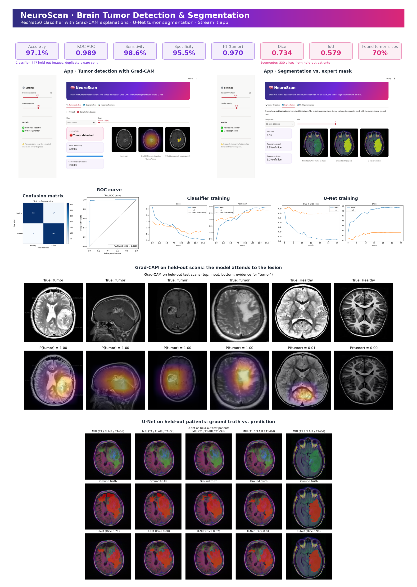

A deep learning project for binary classification and pixel-level segmentation of brain tumor MRI scans using CNNs (ResNet) and U-Net architectures. Includes data preprocessing, training scripts, and an interactive Streamlit app for visualization.

**Highlights:** 97.1% accuracy and 0.989 ROC AUC on tumor detection · 0.73 Dice on tumor segmentation for unseen patients · Grad-CAM explanations · a three-tab Streamlit app.

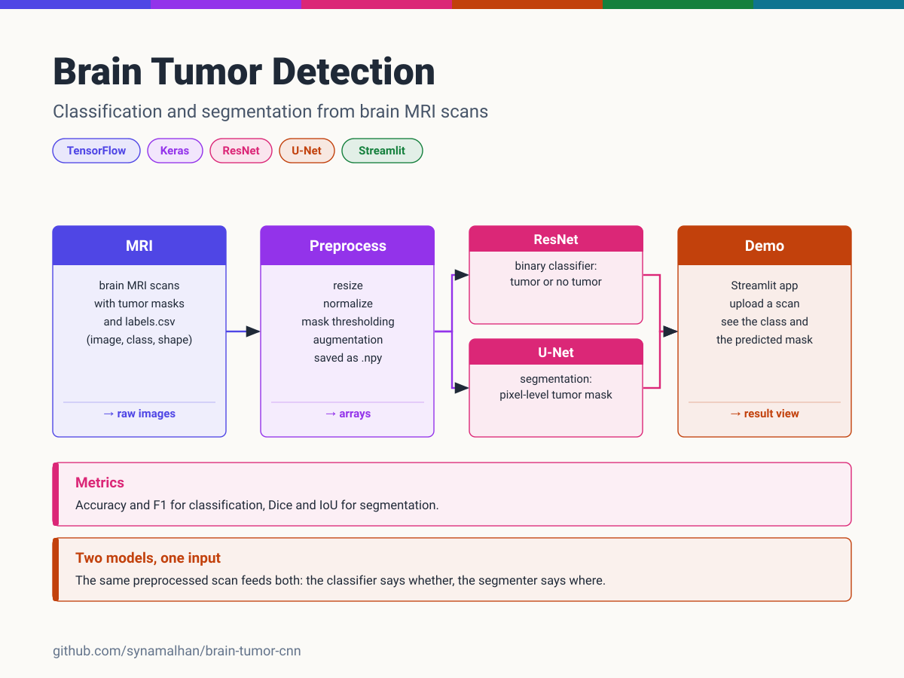

---

## The App: NeuroScan

`streamlit run app/streamlit_app.py` opens a three-tab interface:

| Tumor detection | Segmentation |
|---|---|
| 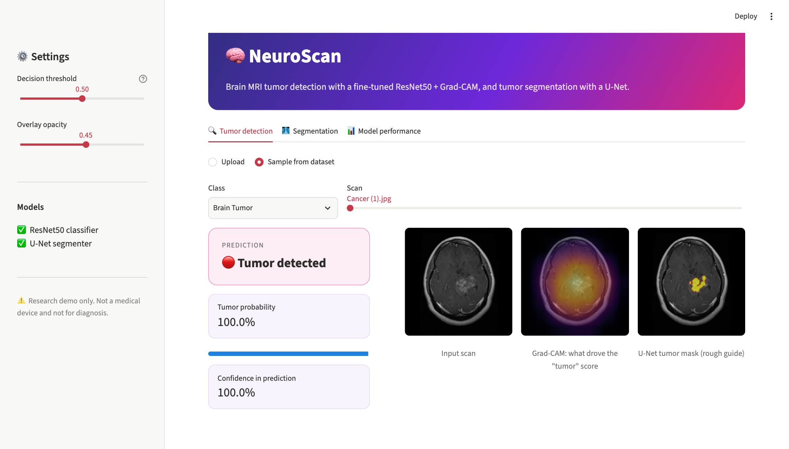 | 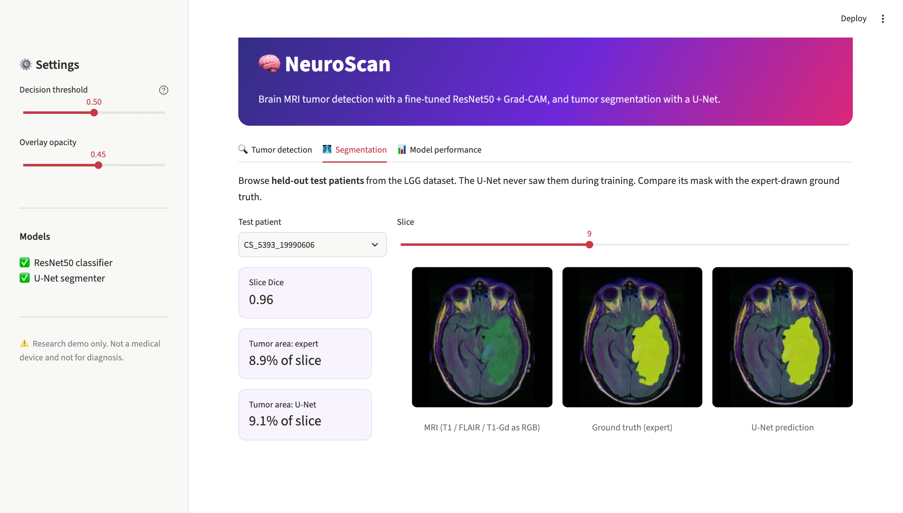 |
| Upload a scan or pick one from the dataset. You get a verdict, the tumor probability, a Grad-CAM heatmap and the U-Net mask. | Browse held-out LGG test patients slice by slice and compare the U-Net mask with the expert mask, with a Dice score for each slice. |
| 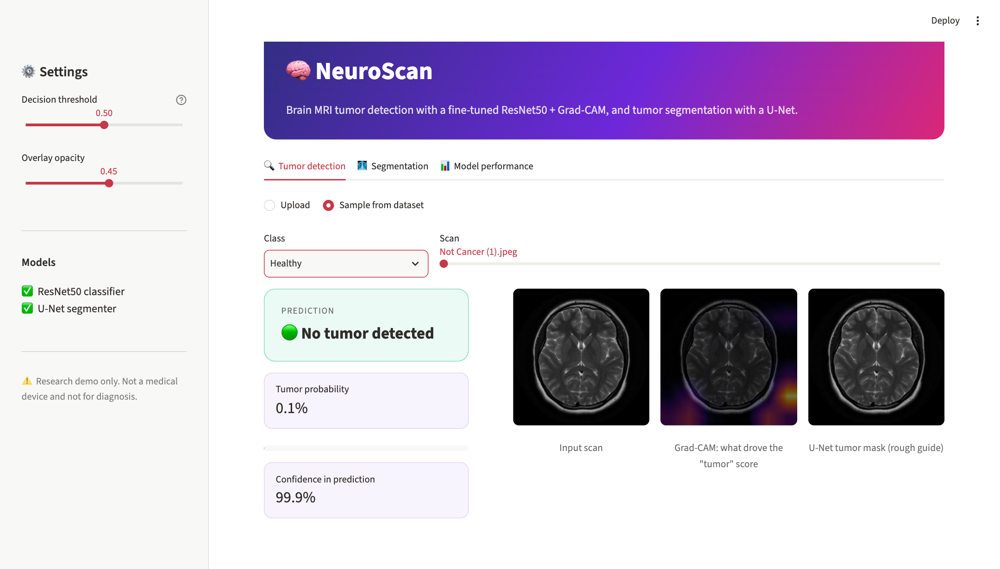 | 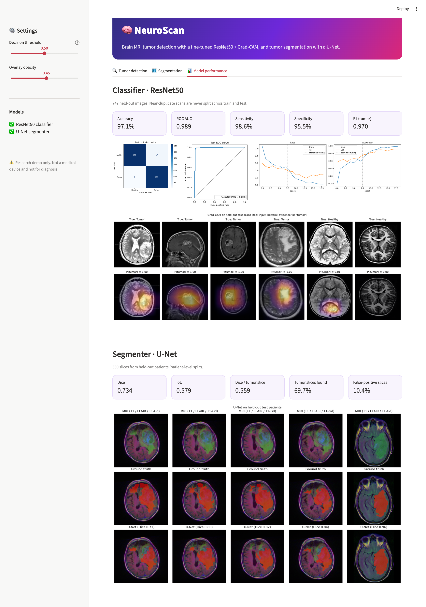 |
| Healthy scans come back clean: 0.1% tumor probability, with no strong heatmap response. | **Model performance:** test metrics, confusion matrix, ROC and training curves, plus example predictions for both models. |

The sidebar has an adjustable decision threshold and overlay opacity.

---

## Results (classifier)

Tested on **747 held-out MRI scans** that the model never saw during training or model selection.

| Metric | Before | **After** |
|---|---|---|
| Accuracy | 74.0% | **97.1%** |
| ROC AUC | 0.799 | **0.989** |
| Tumor recall (sensitivity) | 86% | **98.6%** |
| Healthy recall (specificity) | 60% | **95.5%** |
| Tumor F1 | 0.79 | **0.970** |

Confusion matrix: 360 of 365 tumors caught, 17 of 382 healthy scans falsely flagged. Raw numbers are in [`docs/results/metrics.json`](docs/results/metrics.json).

<p>
  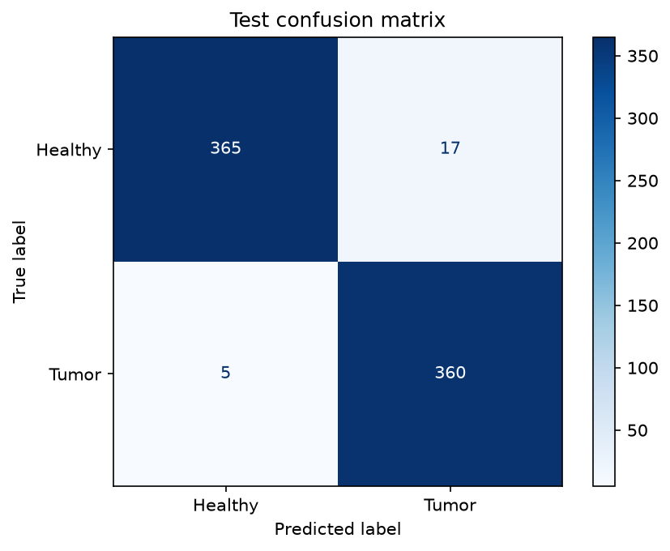
  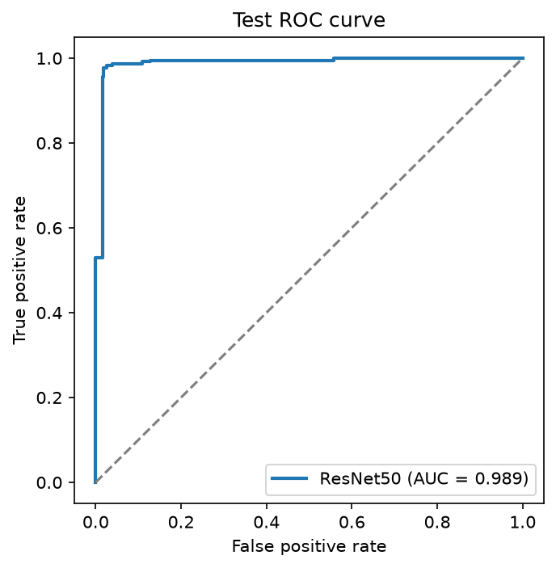
</p>

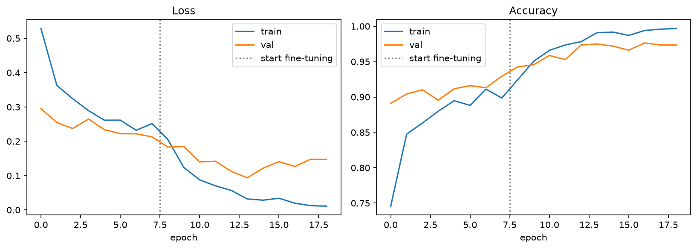

**Grad-CAM: where the model looks.** On held-out tumor scans, the evidence for "tumor" falls on the lesion itself:

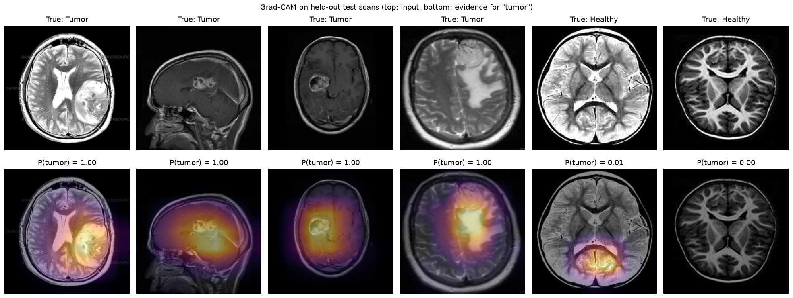

### What changed

1. **Fixed input preprocessing (biggest gain).** The ImageNet ResNet50 was given images scaled to `[0, 1]`, but its weights expect ImageNet "caffe" preprocessing (BGR, mean-subtracted, 0-255). That step now lives inside the model, so the model, training script and app all take raw 0-255 RGB images.
2. **Leak-free split.** About 2,100 of the 4,600 images are re-encoded or resized copies of the same scan (for example `Cancer (1).jpg` and `Cancer (1).tif`). A random split put copies of the same scan in both train and test, which inflates scores. Images are now grouped by perceptual hash, and the 70/15/15 split never separates a group (3,212 unique scans). The "before" numbers above come from the old random split, so the old model's honest accuracy was likely even lower.
3. **Two-phase transfer learning.** The classifier head is trained on frozen features for 8 epochs. Then the `conv5` stage is fine-tuned at a learning rate of 1e-5 (BatchNorm stays frozen), with LR decay, early stopping on validation AUC, and the best checkpoint restored.
4. **Augmentation.** Random flip, rotation, zoom and contrast, active only during training.

> Research and education project only. This is not a medical device. The dataset is a mix of web-sourced MRI slices from different scanners and sequences, so performance on real clinical data will differ.

---

## Results (segmentation)

The U-Net is trained on the [LGG MRI Segmentation](https://www.kaggle.com/datasets/mateuszbuda/lgg-mri-segmentation) dataset (110 patients, 3,929 slices with expert tumor masks). The split is by patient (80/10/10), so every test patient is unseen. It was tested on **330 slices from 11 held-out patients**.

| Metric | Test |
|---|---|
| Dice (all test pixels) | **0.734** |
| IoU (all test pixels) | **0.579** |
| Mean Dice on slices that contain tumor | 0.559 |
| Tumor slices where any tumor was found | 69.7% |
| Tumor-free slices with a false-positive mask | 10.4% |

Numbers are in [`docs/results/segmentation_metrics.json`](docs/results/segmentation_metrics.json). The model segments large tumors well (Dice 0.71–0.96 below). Most misses are small tumors at the edges of the tumor volume, which pulls down the per-slice average.

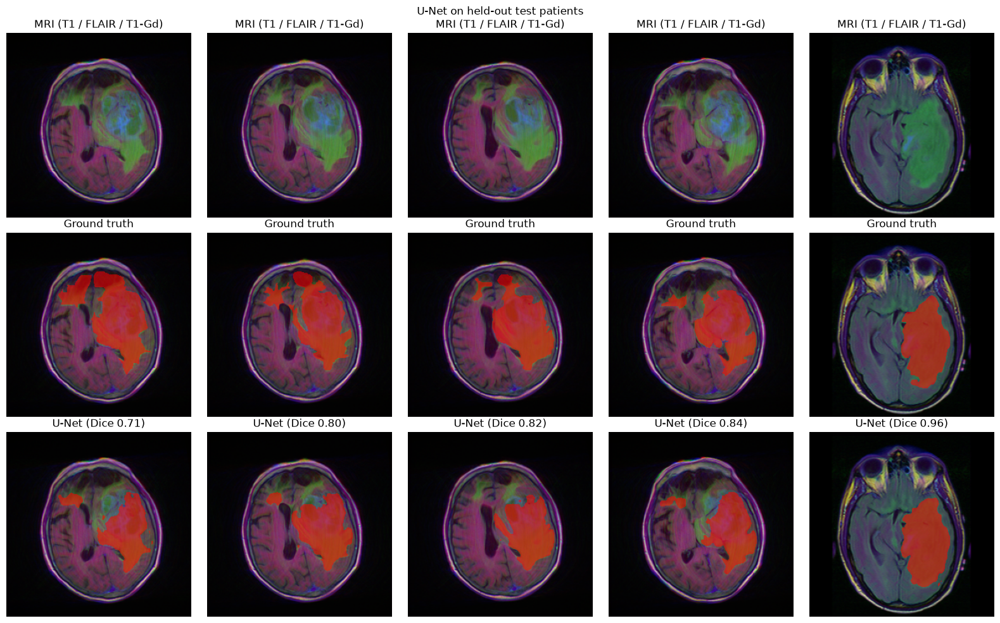

The inputs are the dataset's 3-channel slices: pre-contrast, FLAIR and post-contrast stacked as RGB. Training used BCE + Dice loss with a width-16 U-Net (about 2M parameters). The original 64-filter version needed about 46 minutes per epoch on CPU; this one takes about 4. The validation Dice in the training curves below looks low (about 0.36) because Keras averages a soft, per-batch Dice, and many validation batches contain no tumor. Scored per slice on thresholded masks, validation Dice is similar to the test numbers above.

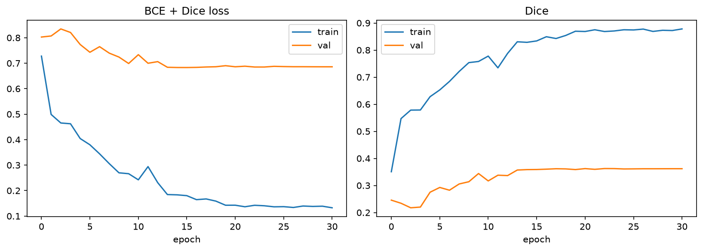

---

## Project Structure

```
BrainTumorCNN/
│
├── data/download/                  # Classification dataset (not committed)
├── data/lgg/kaggle_3m/             # Segmentation dataset (not committed)
│
├── notebooks/
│   ├── 1_data_preprocessing.ipynb  # Data exploration + leak-free split
│   ├── 2_model_testing.ipynb       # Classifier evaluation + Grad-CAM
│   └── 3_unet_segmentation.ipynb   # U-Net evaluation
│
├── models/
│   ├── resnet_classifier.py        # Binary classification model
│   └── unet_model.py               # U-Net segmentation model
│
├── scripts/
│   ├── train_classifier.py         # Train + evaluate (writes docs/results/)
│   ├── gradcam_examples.py
│   ├── make_overview.py            # Builds docs/overview.png
│   └── train_unet.py
│
├── utils/
│   └── preprocessing.py            # Loading, resizing, normalizing images/masks
│
├── saved_models/
│   ├── resnet_classifier.weights.h5
│   └── unet_model.keras
│
├── app/
│   └── streamlit_app.py            # NeuroScan interactive demo app
│
├── docs/
│   ├── overview.png                # One-page summary (scripts/make_overview.py)
│   ├── results/                    # Metrics, plots, Grad-CAM + segmentation examples
│   └── ui/                         # App screenshots
│
├── requirements.txt
└── README.md
```

---

## Features

- ResNet-based binary classifier for tumor detection  
- U-Net-based segmentation model for localizing tumor regions  
- Data normalization, augmentation, and binary mask thresholding  
- Evaluation with accuracy, F1-score, Dice, and IoU  
- Grad-CAM explanations of classifier decisions  
- Interactive **Streamlit App** (NeuroScan) to visualize predictions

---

## Usage

### 1. Install dependencies (Python 3.11)
```
python3.11 -m venv .venv && source .venv/bin/activate
pip install -r requirements.txt
```

### 2. Get the data
Download the [Brain Tumor Dataset](https://www.kaggle.com/datasets/preetviradiya/brian-tumor-dataset) (4,600 images, tumor/healthy) and the [LGG segmentation dataset](https://www.kaggle.com/datasets/mateuszbuda/lgg-mri-segmentation) (about 750 MB):
```
mkdir -p data/download data/lgg
curl -L -o data/download/ds.zip https://www.kaggle.com/api/v1/datasets/download/preetviradiya/brian-tumor-dataset
curl -L -o data/lgg/lgg.zip https://www.kaggle.com/api/v1/datasets/download/mateuszbuda/lgg-mri-segmentation
(cd data/download && unzip -q ds.zip) && (cd data/lgg && unzip -q lgg.zip && rm -rf lgg-mri-segmentation)
```

### 3. Train and evaluate the classifier
```
python -m scripts.train_classifier
```
This takes about 30 minutes on an M3 Pro CPU. It writes `saved_models/resnet_classifier.weights.h5` plus the metrics and plots in `docs/results/`. `python scripts/gradcam_examples.py` regenerates the Grad-CAM figure.

### 4. Train and evaluate the segmentation model
```
python -m scripts.train_unet
```
This takes about 2 hours on an M3 Pro CPU (about 4 minutes per epoch, with early stopping). It writes `saved_models/unet_model.keras` and the `segmentation_*` files in `docs/results/`. Use `--base-filters 64` for the full-width original U-Net if you have a GPU.

### 5. Run the app
```
streamlit run app/streamlit_app.py
```
This opens **NeuroScan** with three tabs: tumor detection, segmentation and model performance (see [The App](#the-app-neuroscan)). Tabs whose model or dataset is missing tell you which command to run.

---

## Metrics Tracked

- Accuracy, Precision, Recall, F1 (Classification)  
- Dice Coefficient, IoU (Segmentation)  
- Confusion Matrix  
- ROC AUC  
- Training curves, ROC curve, Grad-CAM and segmentation figures in `docs/results/`

---

## Dependencies

- Python 3.11  
- TensorFlow  
- NumPy, pandas, scikit-learn  
- Matplotlib, seaborn  
- Streamlit (for app UI)

---

## Dataset

You can use public datasets like:

- Classification: [Brain Tumor Dataset (Kaggle)](https://www.kaggle.com/datasets/preetviradiya/brian-tumor-dataset) (used for the classifier results)  
- Segmentation: [LGG MRI Segmentation (Kaggle)](https://www.kaggle.com/datasets/mateuszbuda/lgg-mri-segmentation) (used for the U-Net results)  
- [Medical Segmentation Decathlon - Task 1 (BraTS)](http://medicaldecathlon.com/)

---

## Future Work

- Multi-class classification (e.g., glioma, meningioma, pituitary)  
- Multi-modal input (T1, T2, FLAIR)  
- Model ensembling  
- Better postprocessing for masks; a GPU-trained full-width U-Net with augmentation  
- The U-Net is trained on LGG FLAIR-style slices, so its masks on other scan types in the app are a rough guide only

---

## Contributing

Pull requests are welcome! For major changes, please open an issue first.

---

## License

[MIT License](LICENSE)
